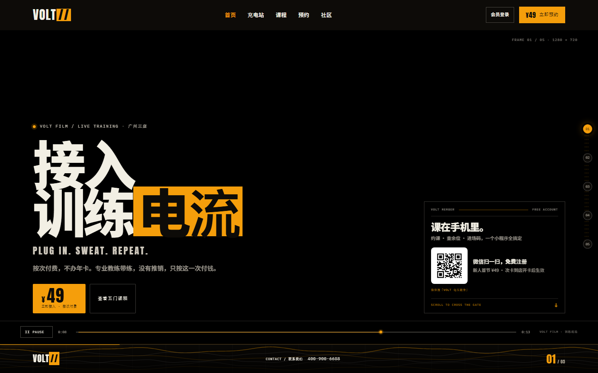
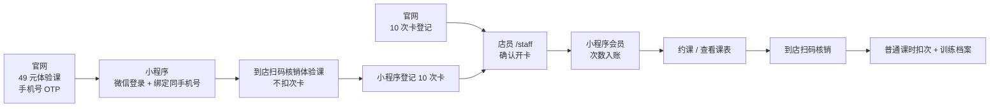
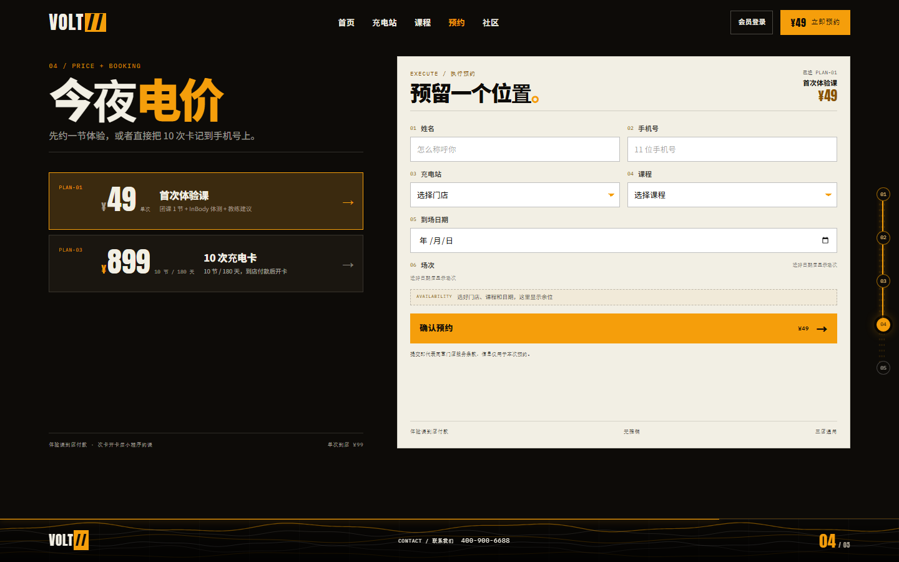
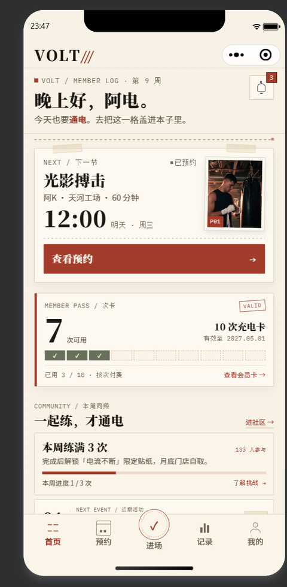
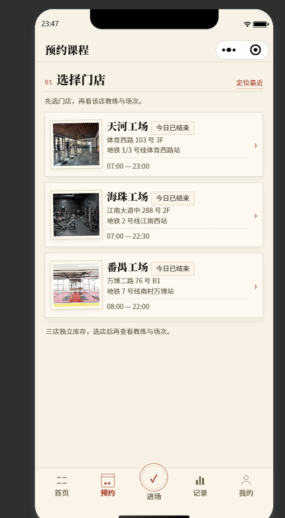
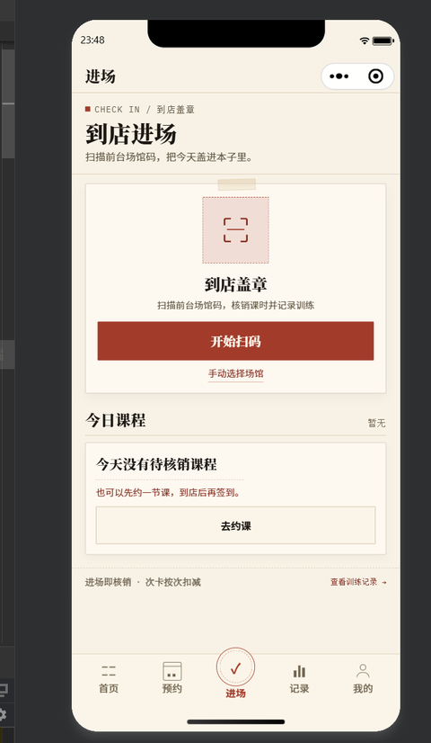
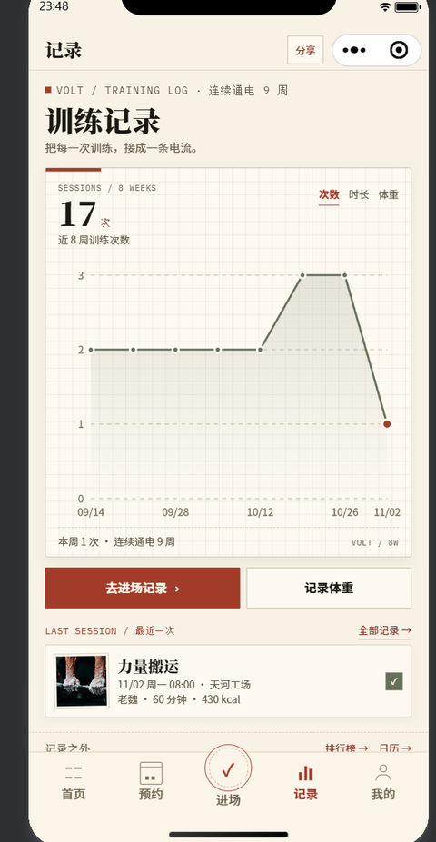
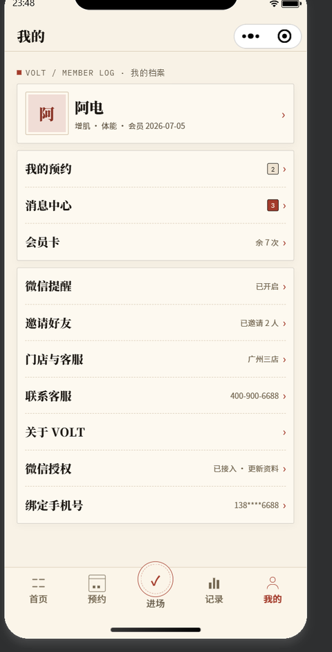
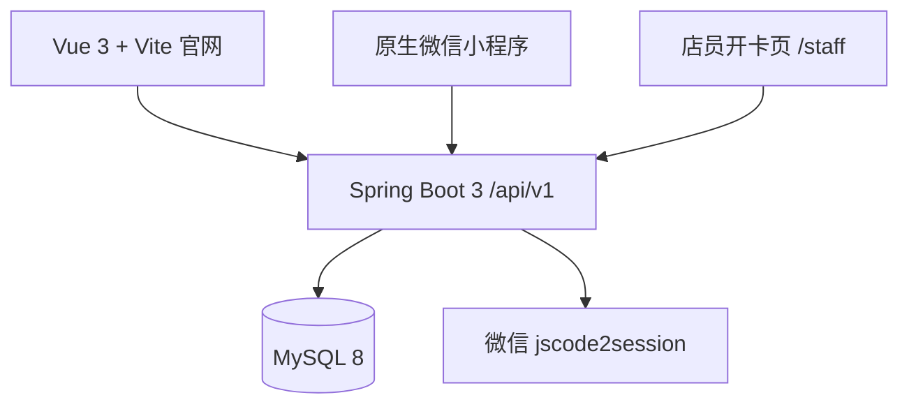

# VOLT 健身｜官网 + 微信小程序 + 后端

**一个把「官网获客 → 购卡登记 → 到店开卡 → 小程序约课 → 扫码核销」串起来的健身品牌全栈 Demo。**

<p align="center">
  
</p>

## 30 秒了解

| 项目 | 说明 |
| --- | --- |
| 项目定位 | 健身品牌的三端 Demo：Vue 3 官网、原生微信小程序、Spring Boot 后端 |
| 解决的业务 | 官网卖体验课、登记次卡；到店付款后店员开卡；会员在小程序约课、签到、扣次 |
| 我的角色 | 全栈开发（AI 辅助）：页面、接口与联调在 AI 辅助下完成，业务流程拆解、关键逻辑确认和验收自行负责 |
| 项目规模 | 官网 5 屏、小程序 18 页、30+ 后端接口、MySQL 8 数据库 |
| 工程验证 | 接口契约自检 **56/56 通过**；官网 Vite 构建通过；小程序 JS/JSON 静态检查通过 |
| 重要边界 | 在线支付/退款未接入：官网体验课与购卡到店付款，店员确认开卡；小程序另有明确标注的演示支付开关。短信 OTP 本地显示 devCode，生产需接真实短信通道 |

## 核心流程



- 官网只做「体验课预约」和「购卡登记」，不会把买卡伪装成一次预约；体验课不选课程，按门店 + 日期选择可约时段。
- 体验课预约先做手机号 OTP，创建/登录手机号会员；小程序微信登录绑定同一手机号后合并，预约保留。体验课核销不扣次卡，每手机号限一次。
- 会员账号和次卡权益分开：微信登录只是账号，开卡确认后才写入次数；之后约课、扫码核销才按次扣减。
- 同一个微信可关联多个手机号会员档案，在「我的」切换会员卡；手机号是会员唯一标识，不同档案的余额、预约与流水互相隔离。
- 「我的」头像进入个人资料页，可改昵称/目标/身高体重，并上传本地头像（本地存 `backend/uploads/avatars`，生产应换对象存储）。
- 未绑定手机号的新会员进入首页时会弹出手机号验证弹窗；绑定后自动识别「已开卡 / 体验课 / 路人」，再按身份引导约课或购卡。

## 界面截图

### 官网

<table>
  <tr>
    <td width="50%"><br><sub>首页：品牌影片、体验课入口、会员小程序入口</sub></td>
    <td width="50%"><br><sub>04 屏：体验课预约与 10 次卡登记拆成两条路径</sub></td>
  </tr>
</table>

### 微信小程序

<table>
  <tr>
    <td align="center"><br><sub>会员首页</sub></td>
    <td align="center"><br><sub>选店约课</sub></td>
    <td align="center"><br><sub>到店进场</sub></td>
    <td align="center"><br><sub>训练记录</sub></td>
    <td align="center"><br><sub>我的 / 会员卡入口</sub></td>
  </tr>
</table>

> 小程序截图为开发者工具/真机实际页面；支付相关按钮为本地「演示支付」，不代表真实微信支付。

## 技术架构



| 层 | 技术 | 负责什么 |
| --- | --- | --- |
| 官网 | Vue 3 · Vite · 原生 CSS | 品牌展示、体验课预约、购卡登记、会员登录、店员开卡 |
| 小程序 | 原生微信小程序 · Canvas 2D | 微信登录、手机号 OTP 绑定、课表、约课、进场、会员卡、次卡流水、训练档案 |
| 后端 | Spring Boot 3.5 · Java 17 · MyBatis | 场次库存、预约、候补、核销、卡单、会员合并、幂等 |
| 数据库 | MySQL 8 | 会员、场次、预约、购卡单、次卡流水、训练档案 |

## 这个项目不只做 CRUD

- **场次库存**：锁位 10 分钟、超时释放、原子扣库存，满员进入候补，取消后按顺序递补。
- **重复提交**：预约、锁位、核销等写请求带幂等键，同一操作重试不生成第二张单、不重复扣次。
- **会员身份**：微信登录创建账号，手机号 OTP 验证后绑定/合并官网会员与购卡单；合并时保留次卡并换发 token。
- **次卡状态**：购卡登记 → 店员开卡 → 权益入账 → 核销扣次 → 次卡流水，每一步都有明确状态。
- **契约自检**：`tools/api-check.mjs` 覆盖 56 项真实接口，改后端后可快速回归。

## 快速体验

### 1. 后端（端口 8080）

```bash
cd backend
cp .env.example .env      # 第一次运行：填写本地 MySQL 账号密码
mvn spring-boot:run
```

首次启动会自动建库、建表并生成今天起 60 天的场次。`backend/.env` 已被 gitignore，不要提交真实密码。

本地演示可配置：

```dotenv
VOLT_EXPOSE_OTP=true       # 手机号验证码在接口响应里返回 devCode
VOLT_STAFF_KEY=volt-staff-demo
VOLT_DEMO_PAY=true         # 小程序显示「演示支付并开卡」
WX_DEMO_FALLBACK=true      # 未配置 AppSecret 时落到演示会员 MBR-DEMO
```

### 2. 官网（默认 5173）

```bash
cd website
npm install
npm run dev
```

- 官网：`http://localhost:5173/`
- 店员开卡：`http://localhost:5173/#staff`，密钥使用 `VOLT_STAFF_KEY`
- 门店核销码：`http://localhost:5173/#qr`，会员手机扫码核销；开发者工具里扫码按钮会自动转为手动选场馆

### 3. 微信小程序

微信开发者工具导入 [`miniprogram/`](miniprogram/) 目录（不是仓库根目录），关闭「校验合法域名」后编译。真机联调把 [`miniprogram/config/index.js`](miniprogram/config/index.js) 的 `API_BASE` 改成电脑局域网 IP。

演示录制时 `FORCE_LOGIN: true` 会让每次冷启动清掉旧会话、先走独立登录页，确保能看到微信授权；录完改回 `false`，否则每次重新打开小程序都要重新登录。`AUTO_LOGIN` 只在 `FORCE_LOGIN` 关闭且没有本地 session 时生效。

未配置微信 AppSecret 且打开 `WX_DEMO_FALLBACK=true` 时，`wx.login` 会落到演示会员 `MBR-DEMO`；配置真实 AppSecret 后走 `jscode2session`，新微信会创建真实会员。当前演示环境已配置真实 AppSecret，登录身份以真实 openid 为准。

### 4. 真机演示与扫码核销

- 手机和电脑连同一个 Wi-Fi；把 `miniprogram/config/index.js` 的 `API_BASE` 改成 `http://<电脑局域网IP>:8080/api/v1`，并确保防火墙放行 8080。
- 电脑打开 `http://localhost:5173/#qr`，手机进入小程序「进场 → 开始扫码」，扫描对应门店二维码；体验课和普通课走同一套核销。
- 真机预览如果拦截本地 HTTP，改用开发者工具的「真机调试」，或给后端加 HTTPS/域名白名单。
- 开发者工具里点「开始扫码」会自动打开「手动选择场馆」，不依赖相机；适合稳定录屏。

要重复演示真实微信的「登录 → 绑定手机号」：

1. 执行 `mysql -u <user> -p <db> < backend/src/main/resources/db/demo-reset-current-wechat.sql`，解除当前真实微信会员的手机号并清掉预约/消息；
2. 小程序重新编译或冷启动（`FORCE_LOGIN: true` 会清本地旧会话）；
3. 点微信一键登录，未绑定会员会弹出手机号验证弹窗。

只保留两个演示脚本：`demo-reset.sql` 全量重置演示数据，`demo-reset-current-wechat.sql` 重置当前真实微信会员。完整恢复场次/演示数据执行 `demo-reset.sql` 后重启后端。

## 验证

```bash
# 后端契约自检（需先启动后端；会写入测试数据，建议用临时库）
node tools/api-check.mjs http://localhost:8080/api/v1

# 官网生产构建
cd website && npm run build

# 小程序 JS / JSON 静态检查
find miniprogram -name "*.js" -not -path "*/node_modules/*" -print0 | xargs -0 -n1 node --check
```

当前结果：后端契约 **56/56 通过**；官网构建通过；小程序 JS/JSON 静态检查通过。

## 目录

| 目录 | 内容 |
| --- | --- |
| [`website/`](website/) | Vue 3 官网：首页、门店、课程、预约/购卡、会员登录、店员开卡 |
| [`miniprogram/`](miniprogram/) | 微信小程序：首页、课表、进场、记录、会员卡、社区、邀请、绑定手机号 |
| [`backend/`](backend/) | Spring Boot 后端：目录、预约、库存、会员、卡单、核销、档案 |
| [`docs/`](docs/) | 接口契约、服务职责、官网/小程序接入说明 |
| [`tools/`](tools/) | 接口契约自检脚本 |

更细的接口字段、数据库和联调说明：

- [接口索引](docs/api-index.md)
- [后端最终契约](docs/shared-backend-api-final.md)
- [官网接入](docs/web-integration.md)
- [小程序接入](docs/wx-integration.md)

## Demo 边界

- 在线支付、退款未接入；官网购卡是登记单，到店付款后由店员确认开卡。
- 49 元体验课是到店付费的单次预约：官网先做手机号 OTP，再按门店 + 日期选时段；小程序绑定后如果识别为路人，也可从引导弹窗进入课表体验模式预约。已开卡会员的首节体验课免费（¥0），赠课不扣次卡；同一手机号仍只能预约一次首次体验。小程序核销只确认到场，不校验支付状态。
- `VOLT_DEMO_PAY=true` 时小程序提供「演示支付并开卡」，只改业务状态，不调用微信支付。
- 短信通道未接入，本地通过 `VOLT_EXPOSE_OTP=true` 显示 devCode；生产需接真实短信或微信手机号授权。
- 微信登录未配置 AppSecret 时使用演示会员映射，不能用于生产。
- 店员开卡页使用单一 `VOLT_STAFF_KEY`，生产建议替换为店员账号、角色与操作审计。
- 社区排行榜/故事是演示内容，不代表真实运营数据。

---

**VOLT / PLUG IN. SWEAT. REPEAT.**
